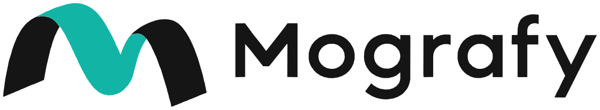

<p align="center">
  <picture>
    <source media="(prefers-color-scheme: dark)" srcset="docs/brand/mografy-logo-inverse.svg">
    
  </picture>
</p>

# Mografy

[English](README.md) | [繁體中文](README.zh-TW.md)

Mografy is a local Canvas animation tool for Claude Code and Codex. One shared `mografy` Skill helps the agent plan storyboards, adapt working examples, write scenes, review frames, and export the result. The browser player provides playback, scrubbing, subtitles, colors, effects, and audio controls.

Describe the animation in your agent, then watch it in `mografy dev`. The agent edits scene files; Mografy compiles and trial-renders them in Chromium before updating the player at the same time position.

[](https://github.com/zz41354899/mografy/raw/refs/heads/main/docs/media/mografy-intro.mp4)

[Watch the intro with audio (MP4)](https://github.com/zz41354899/mografy/raw/refs/heads/main/docs/media/mografy-intro.mp4).

## Latest updates

**2026-10-21** — Contextual music: the agent describes what each part of the film needs and an optional generator composes a score that lands on its moments; 3D layers with Three.js; a project style file (`style.md`) that fixes a project's design and motion decisions; and the shared Skill now keeps itself up to date after every install, build or update.

**2026-10-20** — Edits no longer get stuck behind a stalled scene or a long review; the `mografy` command keeps working when the folder it was installed from is moved or deleted. See the [changelog](CHANGELOG.md).

## Get started

You need [Node.js](https://nodejs.org/) 22.12 or later. Then run:

```sh
git clone https://github.com/zz41354899/mografy.git
cd mografy
npm install -g pnpm
pnpm install
mografy dev
```

`pnpm install` installs dependencies and then, automatically, builds Mografy, downloads the Chromium it uses for checks and exports, and puts the `mografy` command on your PATH. `mografy dev` opens the player with the sixteen built-in animations. If you see them, the installation works.

To check for updates, run `mografy update --check`. To install the latest commit from your branch's tracked upstream, run `mografy update` from the Mografy folder. The command checks for local changes, waits for an active export to finish, stops the active player, fast-forwards the source, runs `pnpm install` (including build, Chromium setup and launcher refresh), synchronizes the shared Skill, then restarts the same project on the same port. Refresh the browser after it restarts. Without an active player, it updates the installation without opening a project.

If your installation predates the update command, stop the player with Ctrl+C and run this once in the original Mografy checkout:

```sh
git pull --ff-only
pnpm install
mografy dev
```

`--check` fetches Git metadata but does not change working files, install dependencies or restart the player. Updates stop for local changes (including untracked files), missing upstreams, detached HEADs or diverged history. User projects ignored by Git stay in place. If dependency setup fails after the source update, the player stays stopped and the error lists recovery commands. Separate checkouts update independently; outside a checkout, the PATH launcher selects its installed copy.

`npm install -g pnpm` installs the pnpm package manager; skip it if you already have pnpm. pnpm switches to the version Mografy pins in `package.json` by itself. If npm reports a permission error, run `sudo npm install -g pnpm`. Contributors changing Mografy itself also need `pnpm check` and `pnpm test:browser`; see [Development and architecture](#development-and-architecture).

### More setup options

Open the bundled intro, or a project you already have:

```sh
mografy dev ./examples/mografy-intro
mografy dev ./projects/my-animation
```

New animations are created in the `projects/` folder. To keep them somewhere else, set `MOGRAFY_HOME` before starting the player:

```sh
export MOGRAFY_HOME="$HOME/Animations"
```

Other settings, such as the default project and the FFmpeg path, are in [configuration](docs/configuration.md).

## Create your first animation

1. Run `mografy dev` to open the player. No starter project is needed; after `pnpm install` it opens with the built-in animations.
2. Open the repository in Codex or Claude Code and describe the animation, naming the project folder. The agent creates the project and the player switches to it. The shared Skill guides scene authoring and review.
3. Watch the player update after each successful compile and Chromium trial render. Scrub to check timing and adjust the exposed scene controls.
4. Run `mografy check ./projects/my-animation` and `mografy review ./projects/my-animation`, then inspect the generated images. Export from the player or CLI when ready.

For example:

> Create an eight-second 9:16 animation in `projects/my-animation`, with a native 1080 × 1920 canvas. Use the Typewriter and Logo reveal components as references. Show “Hello, Mografy.”, then reveal the logo with a teal accent. Review the actual frames and export an MP4.

For a longer sequence, ask for a storyboard first. Scene code determines the composition; the player exposes the parameters declared by that scene.

## One Skill for Codex and Claude

Based on the maintainer's current experience, the Claude workflow is more fully calibrated. Codex can adapt its approach to the brief and rendered results while following the shared scene contract.

The Skill lives at [`.agents/skills/mografy/SKILL.md`](https://github.com/zz41354899/mografy/blob/main/.agents/skills/mografy/SKILL.md), outside animation subprojects. Claude's `.claude/skills/mografy` entry links to that same folder, and [CLAUDE.md](https://github.com/zz41354899/mografy/blob/main/CLAUDE.md) imports it. Both hosts read one maintained copy.

Its English references cover:

| Reference | Use |
| --- | --- |
| [Project](https://github.com/zz41354899/mografy/blob/main/.agents/skills/mografy/references/project.md) | Repository sources, architecture, and development checks |
| [Scene authoring](https://github.com/zz41354899/mografy/blob/main/.agents/skills/mografy/references/scene-authoring.md) | Scene contract, drawing API, validation, review, and export |
| [Built-in components](https://github.com/zz41354899/mografy/blob/main/.agents/skills/mografy/references/built-in-components.md) | All sixteen working component scenes and how to adapt them |
| [Intro](https://github.com/zz41354899/mografy/blob/main/.agents/skills/mografy/references/intro.md) | The existing twelve-second film, its source, assets, timing, and review points |
| [Storyboards](https://github.com/zz41354899/mografy/blob/main/.agents/skills/mografy/references/storyboard.md) | Shot planning and host-specific visual boards |
| [Animation principles](https://github.com/zz41354899/mografy/blob/main/.agents/skills/mografy/references/animation-principles.md) | The twelve principles applied to deterministic Canvas motion |
| [Codex motion design](https://github.com/zz41354899/mografy/blob/main/.agents/skills/mografy/references/codex-motion-design.md) | Codex-specific guidance for visual concepts, choreography, continuity, rhythm, and design review; Claude retains its existing workflow |
| [Camera and transitions](https://github.com/zz41354899/mografy/blob/main/.agents/skills/mografy/references/camera-transitions.md) | `cinema.ts` camera moves, transitions including sakura particle wipes, and atmosphere |
| [CJK typography](https://github.com/zz41354899/mografy/blob/main/.agents/skills/mografy/references/cjk-typography.md) | Vertical Japanese / Chinese text, CJK line breaking, and the bundled OFL fonts |
| [Video compression](https://github.com/zz41354899/mografy/blob/main/.agents/skills/mografy/references/video-compression.md) | Python helper for smaller exported MP4s, quality controls, and upload-size budgets |

[packages/core/src/guide.ts](https://github.com/zz41354899/mografy/blob/main/packages/core/src/guide.ts) owns the generated entrypoint and references. After editing it, run `pnpm build`: it ends with `pnpm sync:skills`, which regenerates the Skill. `pnpm install` and `mografy update` build too, and `mografy dev` regenerates the Skill on start when its sources changed since the last sync (for example after a `git pull`). Animation projects receive `AGENTS.md` and `CLAUDE.md` pointers to the shared Skill.

## Working examples

The sixteen built-in animations are authoring references as well as playable examples:

- **Text and numbers:** Stagger text, Typewriter, Lower third, Count up.
- **Brand and layout:** Pop card, Logo reveal, Social card, Follow badge.
- **Interactions:** YouTube subscribe, AI chat, Like burst, Notification toast, Toggle switch.
- **Indicators:** Progress bar, Pulse dots, Audio wave.

Reusable functions live in [components.ts](https://github.com/zz41354899/mografy/blob/main/packages/server/template/scenes/components.ts) and [social-components.ts](https://github.com/zz41354899/mografy/blob/main/packages/server/template/scenes/social-components.ts). Each example has its own scene entry, controls, preview, and export. Source copies live under `packages/server/template/scenes/`; editable installed projects live under the library's `.components/{id}/` directory. New projects include the reusable modules and scene entries.

All sixteen built-in component projects default to centered **9:16 portrait** previews. Their bundled thumbnails also show the full portrait canvas, so a new installation can show all sixteen previews before opening their projects. Scene edits refresh the opened project's thumbnail automatically. After changing built-in source scenes or assets, maintainers regenerate the bundled previews with `pnpm thumbnails:generate`.

Optional [extras](https://github.com/zz41354899/mografy/tree/main/extras) are not installed; installation contains only the sixteen built-in components. The agent copies an extra into a project when the brief needs it: [cinema.ts](https://github.com/zz41354899/mografy/blob/main/extras/cinema/cinema.ts) for camera moves on image plates, transitions (crossfade, dip, flash, iris, slash, whip, sakura-style particle wipes) and atmosphere, and [cjk.ts](https://github.com/zz41354899/mografy/blob/main/extras/cjk/cjk.ts) with OFL Noto Sans / Serif CJK TC subsets for vertical Japanese / Chinese text and CJK line breaking. See the [camera and transition](https://github.com/zz41354899/mografy/blob/main/.agents/skills/mografy/references/camera-transitions.md) and [CJK typography](https://github.com/zz41354899/mografy/blob/main/.agents/skills/mografy/references/cjk-typography.md) references.

The [component reference](https://github.com/zz41354899/mografy/blob/main/.agents/skills/mografy/references/built-in-components.md) links every entry and explains layout, timing, local imports, and review. Ask the agent to adapt the relevant component to your project's own assets and style.

The [Mografy intro](https://github.com/zz41354899/mografy/blob/main/examples/mografy-intro/scenes/main.ts) is a 1920 × 1080, twelve-second, 30fps example: code introduces the idea, a preview plays and scrubs, an external edit updates the picture, and the original logo completes the sequence. Its [reference](https://github.com/zz41354899/mografy/blob/main/.agents/skills/mografy/references/intro.md) documents the four beats, fonts, music, captions, and transition sampling.

## Storyboards and motion direction

For example:

> Create an English storyboard for a twelve-second product intro. Use the Mografy intro as a sequence reference and adapt the logo reveal and lower third components to this project's assets.

The agent writes `storyboards/storyboard.md`, with each shot's time range, purpose, composition, assets, key poses, camera, copy/audio, transition, animation principles, and review times.

Codex invokes image generation for visual panels. Claude uses Artifacts when available, otherwise saves a standalone `storyboards/storyboard.html` preview. Plans and prompts are in English. When implementation is requested, the agent continues into scene modules and validates the actual frames.

The animation reference covers squash and stretch, anticipation, staging, straight ahead action and pose to pose, follow through and overlapping action, slow in and slow out, arcs, secondary action, timing, exaggeration, solid drawing, and appeal. Apply the principles that support each shot and its reading holds.

### Project style

A project can fix its own design and motion decisions in `style.md` at the project root, so every shot and later session follows them: do and don't rules, motion character, palette, type and tempo choices, composition habits and reference stills. The values themselves stay in the scene code, defined once and changed there.

Tell the agent when a decision should last ("always use this teal", "titles always rise from below with a little overshoot") and it records it in `style.md`, updating the value in the scene code when the decision is a value. The style takes precedence over the Skill's default design guidance, never over the scene contract, and your current request still wins. Copy `style.md` to reuse a style in another project.

## Scene model

A scene draws the complete picture from absolute `time`, resolved params, and prepared assets. `mografy.json` stores project settings; animation code lives in scene modules.

```ts
import { ease, lerp, pr } from '@mografy/runtime';
import type { FrameContext } from '@mografy/runtime';

export const meta = { width: 1920, height: 1080, duration: 4, fps: 30, background: '#17191d' };
export const params = {
  accent: { name: 'Accent', type: 'color' as const, default: '#12b5a5' },
};

export function renderFrame(ctx: FrameContext, time: number, params: Readonly<Record<string, unknown>>) {
  const mografy = ctx.draw;
  mografy.fill(String(params.accent));
  mografy.circle(ctx.width / 2, ctx.height / 2, lerp(20, 160, ease.outCubic(pr(time, 0, 0.8))));
}
```

Use `ctx.draw` for common drawing, `ctx.canvas` for native Canvas operations, and `ctx.withCanvas` or `ctx.clip` for isolated scopes. Scenes run only in the browser and must render deterministically when seeking in any order. The player and exports share the same runtime and post-processing. See the [scene-authoring reference](https://github.com/zz41354899/mografy/blob/main/.agents/skills/mografy/references/scene-authoring.md) for the full contract.

After editing a scene:

```sh
mografy check ./projects/my-animation
mografy review ./projects/my-animation
```

`check` compiles and trial-renders in real Chromium. While a player is open for that project, `check` asks the player to rebuild from disk, so the terminal and the player report the same result. `review` creates raw stills, output frames, and transition sheets under `renders/`. Inspect those images for clipping, overlap, legibility, hierarchy, safe margins, reading time, and transition continuity. Review compares against a video only when you pass `--video file.mp4` or the player's last finished MP4/WebM export is of the current version; an older export under `renders/` is ignored.

Scene setup must finish within 30 seconds and the trial render within 20 seconds; each export, still or review frame has a 120-second limit. A scene that exceeds a limit (for example, an `await` in `setup` that never resolves or a loop in `renderFrame` that never ends) is reported as a scene error and the last working version keeps playing, so later edits are not blocked.

## Player and exports

The Scene inspector groups Subtitles, Colors, and Controls. Only strings marked `role: 'subtitle'` appear as editable subtitles; the agent edits other copy in source. The Effects inspector provides Glow and Grain with percentage inputs, reset, and an Original/With effects comparison. Audio supports a track, volume, and beat-grid settings.

The main preview follows the authored scene's dimensions and has no orientation switch. For a new **9:16 portrait** video, ask the agent to create a native 1080 × 1920 scene with vertical layout, wrapped text, and social safe margins. The shared Skill records this requirement. An optional saved `aspectRatio` is also read by agents and the Runtime. Portrait Guides reserve conservative space for social overlays.

Playback supports Space, frame stepping with arrows, beat stepping with Shift+arrows when audio is present, Loop (`L`), Guides (`G`), and Projects (`P`).

Export from the player or CLI:

```sh
mografy export ./projects/my-animation --format mp4
mografy export ./projects/my-animation --format webm
mografy export ./projects/my-animation --format mp4 --orientation portrait --resolution 1080p
mografy export ./projects/my-animation --format lottie -o preview.lottie.json
mografy export ./projects/my-animation --format svga -o preview.svga
```

MP4 uses H.264 video and AAC audio. WebM uses VP9 video and Opus audio at 128 kbps, defaulting to constant quality at CRF 32 rather than the MP4 target bitrate. Both support audio, motion sampling, glow, grain, and encoding controls. Finished files are written under `renders/`.

WebM quality presets:

| Quality | VP9 CRF | Motion samples | Encoder speed |
| --- | --- | --- | --- |
| Draft | 38 | 1 | Very fast |
| Standard | 32 | 4 | Medium |
| High | 26 | 8 | Slow |

The initial WebM draft inherits the project's motion samples and output effects; choosing a quality preset applies the values above. Draft also disables glow and grain. Lower CRF keeps more detail and usually produces larger files; higher CRF favors smaller files. Constant quality varies bitrate with scene complexity and does not guarantee a fixed size. VP9 may encode more slowly than H.264, and size savings depend on the scene and settings. CRF values are codec-specific, so compare actual outputs rather than matching MP4 and WebM numbers. Advanced settings also offer two-pass target bitrate. At equal average bitrate and duration, MP4 and WebM have similar file sizes.

A local comparison of the twelve-second intro at 640 × 360, 30 fps and one motion sample produced an 852,445-byte MP4 and a 300,321-byte WebM (64.77% smaller). Total export times were 15.89 and 17.28 seconds. This compares the formats' default encoding settings, including different audio bitrates; it is not a matched-quality benchmark or a prediction for other scenes. See the [measured comparison](artifacts/webm-export/comparison.json).

Lottie and SVGA package embedded PNG frames, preserving Canvas artwork and effects without editable vector layers or audio. Lottie output is `.lottie.json`; SVGA output is compressed SVGA 2 protobuf.

If a finished video is too large, ask the shared `mografy` Skill to compress it, or run the Python helper directly (Python 3.10+, FFmpeg and ffprobe on PATH):

```sh
python3 .agents/skills/mografy/scripts/compress-video.py ./projects/my-animation/renders/film.mp4
python3 .agents/skills/mografy/scripts/compress-video.py ./projects/my-animation/renders/film.mp4 --target-mb 10 -o ./projects/my-animation/renders/film-share.mp4
```

The default writes a separate `film-compressed.mp4` using CRF 23 and retains audio. `--target-mb` uses two passes and checks the actual decimal MB limit. Existing files are never overwritten; candidates that do not reduce size are discarded. See the [compression reference](https://github.com/zz41354899/mografy/blob/main/.agents/skills/mografy/references/video-compression.md) for quality, resolution, dependency overrides, and result verification. The maintained script is `scripts/compress-video.py`; `pnpm sync:skills` copies it into the shared Skill for both Codex and Claude.

The player's Export dialog offers these output sizes:

| Format | Sizes |
| --- | --- |
| Lottie | 256 × 256 — Square; 640 × 360 — Landscape |
| SVGA | 375 × 375 — Square; 375 × 750 — Portrait |
| MP4 / WebM landscape (16:9) | 1280 × 720 — 720p; 1920 × 1080 — 1080p |
| MP4 / WebM portrait (9:16) | 720 × 1280 — 720p; 1080 × 1920 — 1080p |

MP4 and WebM start in the authored canvas orientation, with icons to switch the output orientation while retaining 720p/1080p quality. A paused-frame preview shows the selected output. Each format remembers its size and Fit selection while the dialog stays open.

When the output aspect differs from the scene, **Fit** appears for all four formats:

| Fit option | Result |
| --- | --- |
| **Fit entire scene** (default) | Center the full artwork, filling extra space with the scene background |
| **Fill and crop** | Fill the output, cropping the centered artwork at the edges |
| **Adapt layout** | Give responsive scene code the output canvas dimensions so it can rearrange the composition |

All sixteen built-in components support landscape and portrait layouts. Choose **Adapt layout** when exporting a component in the other orientation. Custom scenes must use `ctx.width` and `ctx.height` to implement their own responsive layout; selecting this option alone does not rearrange fixed-coordinate artwork.

Output choices leave the main preview and saved project settings intact. Portrait video files default to `name-portrait.mp4` or `name-portrait.webm`. CLI `--orientation` and `--resolution` presets use **Fit entire scene**; `--orientation` alone defaults to 720p, and `--resolution` alone selects landscape. CLI exports without these flags use the project's render scale. Output names supplied with `-o` must be filenames or relative paths inside the project's `renders/` directory.

Mografy exports allow up to **60 fps for MP4 and WebM** and **30 fps for Lottie and SVGA**. SVGA uses its supported rates within this limit. The player, API, CLI, and direct render functions enforce the same limits. The export dialog caps inherited video frame rates at 60 fps without changing saved settings.

After starting a player export, the same dialog shows an animated robot, actual frame-capture progress, and elapsed time. Encoding and packaging use an indeterminate indicator. **Hide** keeps the export running and moves progress into a toast with **View** and **Cancel**; the top **Exporting** button also reopens it.

Completed MP4 and WebM videos can be played and downloaded in the dialog. **Done** dismisses the result, and **Last export** reopens it while the player retains that job. **Export** opens fresh settings. Failed or cancelled jobs offer **Settings** and, for exports started in this dialog, **Retry**.

Progress also appears in the CLI. Cancel a direct CLI export with Ctrl+C, or cancel a player export through the interface or `mografy export [project] --cancel`. Cancellation cleans up temporary data before finishing.

## Commands and project structure

| Command | Purpose |
| --- | --- |
| `mografy dev [project]` | Open the player for an existing project |
| `mografy check [project]` | Compile and trial-render |
| `mografy review [project] [--video file.mp4]` | Generate review images and optional video comparisons |
| `mografy export [project] --format mp4\|webm\|lottie\|svga` | Export the animation |
| `mografy update [--check]` | Update this source installation, or check for a newer revision |
| `mografy stop [project]` | Stop the project's player server |
| `mografy --help` | Show commands and supported options |

`--yes` is deprecated and ignored: `mografy dev` no longer creates missing projects; ask Claude or Codex for a new animation. Use `--no-open` to start the player without opening a browser, and `--port <port>` to choose its port (default: 4173, then the next free port). For `dev`, `check`, `review`, `export`, and `stop`, omitted project paths use `MOGRAFY_PROJECT` when set, otherwise the current project or the source checkout's default project. `mografy init` without a path creates a project in the current folder.

```text
mografy/
  .agents/skills/mografy/       Shared Skill, references, and video-compression helper
  .claude/skills/mografy       Link to the same Skill
  packages/server/template/   Source component library and project template
  examples/mografy-intro/      Twelve-second reference animation
  examples/analytics-product/  Eight-second analytics interaction demo
  examples/mografy-brand/      Eight-second brand introduction
  examples/follow-interaction/ Eight-second Follow button interaction
  projects/                   Editable animation projects and installed components
  docs/                       Architecture and development status

animation-project/
  mografy.json                 Scene entry, aspectRatio, params, fonts, audio, render, review
  scenes/                     Animation code and local reusable components
  style.md                    Optional project style rules
  assets/                     Images, fonts, and audio
  AGENTS.md / CLAUDE.md        Shared Skill pointers
  storyboards/                Written and visual planning outputs
  renders/                    Exports and review images
  .mografy/                   Managed builds and server state
```

## Development and architecture

| Package | Responsibility |
| --- | --- |
| `core` | Settings schema, shared contracts, generated Skill guidance |
| `runtime` | Browser scene execution, drawing, sampling, effects |
| `render` | Compilation, Chromium hosting, exports, frame review |
| `server` | Project write queue, atomic writes, watching, HTTP/WebSocket |
| `web` | Player and inspector |
| `cli` | Development, validation, review, export, project creation |

```sh
pnpm check
pnpm test:browser
pnpm --filter @mografy/web dev
```

Read [architecture](https://github.com/zz41354899/mografy/blob/main/docs/architecture.md) for the data flow and invariants, [status](https://github.com/zz41354899/mografy/blob/main/docs/STATUS.md) for completed work and remaining tasks, and [AGENTS.md](https://github.com/zz41354899/mografy/blob/main/AGENTS.md) before repository changes.

## License

Mografy source code and documentation use the [MIT License](https://github.com/zz41354899/mografy/blob/main/LICENSE), following the [standard MIT text](https://opensource.org/license/mit). Package manifests declare `MIT`. Third-party dependencies and bundled assets retain their original terms; the bundled ABeeZee font uses the [SIL Open Font License](https://github.com/zz41354899/mografy/blob/main/packages/server/template/assets/OFL.txt).
