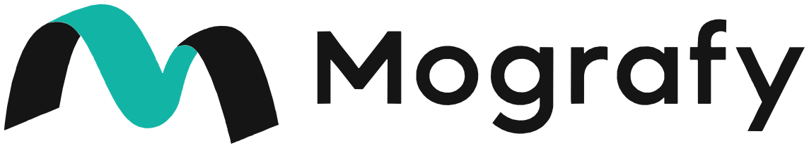

<p align="center">
  <picture>
    <source media="(prefers-color-scheme: dark)" srcset="docs/brand/mografy-logo-inverse.svg">
    
  </picture>
</p>

<p align="center"><b>Some ideas need to move.</b></p>

<p align="center">
  <b>Mografy Triangulum v0.1.0</b> ·
  <a href="CHANGELOG.md">Changelog</a> ·
  <a href="https://www.mografy.app">mografy.app</a> ·
  <a href="README.zh-TW.md">繁體中文</a>
</p>

# Mografy

Mografy makes motion graphics with your coding agent. You describe a film to Claude Code or Codex; the agent writes it as Canvas code with the help of the `mografy` Skill; Mografy compiles it, trial-renders it in Chromium and shows it in a local editor, where you play it, retime its layers, change its colours and export it.

Everything runs on your computer. A film is a folder of plain files you own: a scene in TypeScript, `mografy.json` for its settings, and the assets it uses.

[](https://github.com/mografy/mografy/raw/refs/heads/main/docs/media/mografy-intro.mp4)

[Watch the intro with sound (MP4)](https://github.com/mografy/mografy/raw/refs/heads/main/docs/media/mografy-intro.mp4)

## New in Triangulum v0.1.0

- **A new editor.** A layer timeline where you drag, trim, duplicate, hide, lock and reorder parts of a film and give each one an enter and exit motion; ⌘K search over projects, layers and commands; settings for language, playback, text size and shortcuts.
- **Every film is editable.** A film that marks its shots gets one layer per shot automatically, with no change to its code. Films the agent writes with `timeline()` get one layer per part, such as a title, a card or a logo.
- **A design system for the film.** Swap any colour the film draws, apply motions to all layers at once, set each layer's start and length, and try the scene's own controls, with the film playing beside them. Player, review and export all use the changes.
- **A lighter install.** About 10 MB to check out. FFmpeg and the Chromium shell download the first time they are needed, and Playwright is no longer needed at runtime.
- **An MCP server.** `mografy mcp` lets any MCP client check, preview, review and export your films.

Present mode has been removed so Mografy can focus on making films. See the [changelog](CHANGELOG.md) for everything in this release.

## Get started

You need [Node.js](https://nodejs.org/) 22.12 or later.

```sh
git clone --filter=blob:none --sparse https://github.com/mografy/mografy.git
cd mografy
git sparse-checkout set .agents .claude .github packages scripts projects docs/motion-design examples/mografy-intro
npm install -g pnpm        # skip if you already have pnpm
pnpm install
mografy dev
```

`pnpm install` builds Mografy, fetches the headless Chromium shell it renders with and puts the `mografy` command on your PATH. `mografy dev` opens the editor with sixteen built-in animations. If you can see them, the installation works.

The sparse checkout downloads only what the tool runs on. Templates, extras and reference films download the first time `mografy add` needs them. A plain `git clone` also works, and `git sparse-checkout disable` turns a slim checkout into a full one, which you need if you are changing Mografy itself.

**Updating.** Run `mografy update --check` to see if there is something new, and `mografy update` to install it. It stops the editor, pulls, rebuilds, refreshes the Skill and reopens the same project. It stops without changing anything if you have local changes or your branch has diverged.

**Before your first export.** Video exports use the `ffmpeg` on your PATH if it has every encoder they need. If it does not, the first export downloads one (about 25 MB). To download FFmpeg and Chromium in advance, for example before working offline, run `mografy setup`. Settings such as the projects folder (`MOGRAFY_HOME`) and the browser to use are described in [configuration](docs/configuration.md).

An npm package for people who only make films (`npm install -g mografy`, no Git needed) is in preparation; see [the npm package](docs/npm-package.md).

## Make your first film

1. Run `mografy dev`.
2. In Claude Code or Codex, open the Mografy folder and describe the film, including the folder it should go in:

   > Create an eight-second 9:16 animation in `projects/hello`, 1080 × 1920. Type "Hello, Mografy." like the Typewriter component, then reveal the logo with a teal accent. Review the frames and export an MP4.

3. The agent creates the project and the editor switches to it. Each time the agent saves, Mografy compiles and trial-renders the change and updates the editor at the same moment in the film. If a change breaks the film, the last working version keeps playing and the error is shown.
4. Adjust it in the editor, or ask the agent for more changes. When you are happy with it, export.

For anything longer than a few shots, ask for a storyboard first. The agent writes `storyboards/storyboard.md` and a visual board, then builds the film from it.

## The editor

| Area | What you do there |
| --- | --- |
| **Projects** (left) | Search, recent projects, built-in components; `P` hides it |
| **Preview** | Play, step frames (arrows) or beats (⇧ arrows), loop (`L`), safe-area guides (`G`), zoom, full screen (`F`) |
| **Timeline** | One row per layer. Drag a layer to move it, drag its ends to trim it; right-click to rename, duplicate, hide, lock, change motions or colour. Changes snap to beats, the playhead and other layers (hold ⌘ to turn snapping off), and undo works. |
| **Inspector** (right) | The selected layer, subtitles, the scene's colours and controls, effects (glow, grain) and audio |
| **Design system** | Colours, motion, timing, type and the project's `style.md` |
| **Export / Batch** | Export the open film, or queue several films at once |

Your timeline edits are saved to `scenes/timeline.json` and your colour swaps to `colors` in `mografy.json`. The scene code itself is never changed, so the agent can keep working on the film and your edits stay. If you want to move an element inside a shot on its own, for example a title, ask the agent to give the film layers.

## The Skill

The `mografy` Skill teaches your agent how to plan, write, review and export Mografy films: the scene contract, film architecture (one world, one camera, one beat table), motion design, layers, storyboards, performance, music, 3D, CJK type and output formats. Inside this checkout the agent finds it automatically. To use it from any other folder, install it once with the [skills CLI](https://github.com/vercel-labs/skills):

```sh
npx skills add mografy/mografy -g     # once, for Claude Code, Codex and other agents
npx skills update                        # later, to get the latest version
```

The Skill is written in [`packages/core/skill/`](packages/core/skill/) and generated into [`.agents/skills/mografy/`](.agents/skills/mografy/SKILL.md). `pnpm build`, `pnpm install` and `mografy update` regenerate it, and Claude reads the same files through `.claude/skills/mografy` and `CLAUDE.md`.

## Starting points

- **Templates.** 43 ready-made scenes for product videos: hooks, captions, device screens, steps, numbers, reviews, end cards and transitions. 22 are designed for 9:16 and 21 for 16:9. `mografy add hook-impact three-steps cta-endcard projects/my-film` creates a playable film from them. You can browse them at [mografy.app/library/templates](https://www.mografy.app/en/library/templates).
- **Reference films.** The twelve-second [intro](examples/mografy-intro) comes with the install. The ten `stage-*` product UI loops and the longer films on the [showcase](https://www.mografy.app/showcase) download when you add them, for example `mografy add film-starter projects/my-film`.
- **Built-in components.** Sixteen small animations you can play and adapt: text and numbers, brand and layout, interactions, and indicators.
- **Extras.** Helpers the agent copies into a project only when the film needs them: `cinema` (camera moves and transitions), `cjk` (vertical Chinese and Japanese type), `three` (Three.js 3D), `music` (a score composed to the film's moments), `walkthrough` and `stage` (product UI). For example, `mografy add cinema cjk projects/my-film`.

Run `mografy add` on its own to list all of them.

## How a scene works

A scene draws the whole frame from the absolute `time`, so it can be played, scrubbed and exported in any order:

```ts
import { ease, lerp, pr, timeline } from '@mografy/runtime';
import type { FrameContext } from '@mografy/runtime';
import edits from './timeline.json';

export const TIMELINE = timeline([
  { id: 'dot', name: 'Dot', in: 0, out: 4, enter: 'pop' },
], edits);
export const meta = { width: 1920, height: 1080, duration: 4, fps: 30, background: '#17191d', layers: TIMELINE.meta };
export const params = { accent: { name: 'Accent', type: 'color' as const, default: '#12b5a5' } };

export function renderFrame(ctx: FrameContext, time: number, params: Readonly<Record<string, unknown>>) {
  TIMELINE.draw(ctx.canvas, time, {
    dot: (c, own) => {
      c.fillStyle = String(params.accent);
      c.beginPath(); c.arc(960, 540, lerp(20, 160, ease.outCubic(pr(own, 0, 0.8))), 0, Math.PI * 2); c.fill();
    },
  });
}
```

`@mografy/runtime` provides easing and springs, a film camera, a shot table (`beats`), layers, blur and bloom, text reveals and a tempo grid. After the agent edits a scene it checks the result:

```sh
mografy check projects/my-film          # compile and trial-render in Chromium (--motion also finds jumps)
mografy review projects/my-film         # stills, output frames and transition sheets in renders/
```

The full contract is in the [scene-authoring reference](.agents/skills/mografy/references/scene-authoring.md).

## Export

Export from the editor, or from the command line:

```sh
mografy export projects/my-film                       # MP4, H.265 10-bit
mografy export projects/my-film --preset share        # MP4, H.264, plays everywhere
mografy export projects/my-film --format webm
mografy export projects/my-film --format lottie
mografy export --all                                  # every project, one after another
```

| Preset | Output | Use it for |
| --- | --- | --- |
| `share` | MP4, H.264 8-bit | Any browser, Windows PCs, chat apps and social uploads |
| `high` (default) | MP4, H.265 10-bit | The smallest file at the same quality: Apple devices, Chrome, Edge |
| `fast` | MP4, hardware H.265 10-bit | Quick exports with VideoToolbox, NVENC, Quick Sync or AMF |
| `master` | MOV, ProRes 422 HQ | Editing in Final Cut, Premiere or DaVinci Resolve |

Mografy also exports WebM, Lottie and SVGA. It exports up to 60 fps for video, with motion blur, glow and grain, at 720p or 1080p in landscape or portrait. Files are written to the project's `renders/` folder. [Exports](docs/exports.md) covers codecs, quality settings, output sizes, fit and compression.

## Commands

| Command | What it does |
| --- | --- |
| `mografy dev [project]` | Open the editor |
| `mografy check [project] [--motion]` | Compile and trial-render; `--motion` also finds jumps and hard stops |
| `mografy review [project]` | Write review images |
| `mografy export [project...]` | Export one film or a batch (`--all`) |
| `mografy add [name...] [project]` | Add templates, extras or a reference film |
| `mografy update [--check]` | Update Mografy |
| `mografy setup [--check]` | Download FFmpeg and Chromium now, or show which ones are used |
| `mografy stop [project]` | Stop the editor's server |
| `mografy mcp` | Run the MCP server |
| `mografy --version`, `--help` | Show the version and all options |

### MCP server

`mografy mcp` makes the CLI's operations available to any MCP client over stdio: list and create projects, check, render a frame, review, read and write the scene (the new code is compiled and trial-rendered before it is saved), open the editor, export, and read the Skill. While the editor has a project open, the tools work through it, so you see the same result there.

```sh
claude mcp add mografy -- mografy mcp
codex mcp add mografy -- mografy mcp
```

## A project

```text
my-film/
  mografy.json        scene entry, aspect ratio, colours, fonts, audio, render and review settings
  scenes/             the film's code; timeline.json holds your timeline edits
  style.md            the film's design and motion decisions (optional)
  assets/             images, fonts and audio
  storyboards/        plans and visual boards
  renders/            exports and review images
```

**Only open projects you trust.** A scene runs in the editor page with the editor's access, so opening someone else's project is like running their script. The editor only listens on `127.0.0.1` and refuses requests from other sites.

## Versions

From Mografy Triangulum v0.1.0, Mografy has numbered releases that follow [semantic versioning](https://semver.org): `mografy --version` prints the version you have, and the [changelog](CHANGELOG.md) lists each release. Updates from before v0.1.0 are listed by date.

## Contributing

Mografy is a pnpm monorepo:

| Package | Responsibility |
| --- | --- |
| `core` | Settings and scene schemas, shared contracts, the Skill |
| `runtime` | Running scenes in the browser: drawing, layers, motion, effects |
| `render` | Compiling, Chromium hosting, exports, review |
| `server` | Projects, the write queue, file watching, HTTP and WebSocket |
| `web` | The editor |
| `cli` | The `mografy` command and the MCP server |

```sh
pnpm check
pnpm test:browser
```

Read [AGENTS.md](AGENTS.md) before changing the repository, [architecture](docs/architecture.md) for how data flows, and [status](docs/STATUS.md) for what is done and what is next.

## License

Mografy's code and documentation are released under the [MIT License](LICENSE). Third-party dependencies and bundled assets keep their own licences. The bundled ABeeZee font uses the [SIL Open Font License](packages/server/template/assets/OFL.txt).
