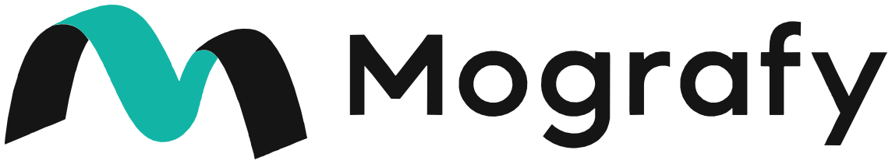

<p align="center">
  <picture>
    <source media="(prefers-color-scheme: dark)" srcset="docs/brand/mografy-logo-inverse.svg">
    
  </picture>
</p>

<p align="center"><b>有些想法，值得動起來。</b></p>

<p align="center">
  <b>Mografy Triangulum v0.1.0</b> ·
  <a href="CHANGELOG.zh-TW.md">更新紀錄</a> ·
  <a href="https://www.mografy.app">mografy.app</a> ·
  <a href="README.md">English</a>
</p>

# Mografy

Mografy 讓你用程式代理（coding agent）做動態設計。你跟 Claude Code 或 Codex 描述想要的影片，代理依照 `mografy` Skill 把它寫成 Canvas 程式碼。Mografy 接著編譯程式碼、在 Chromium 裡試算繪，再把結果顯示在本機的編輯器。你可以在編輯器裡播放影片、調整圖層的時間、換顏色，最後匯出。

所有東西都在你的電腦上執行。一支影片就是一個資料夾，裡面是你自己的檔案：TypeScript 寫的場景、存放設定的 `mografy.json`，以及影片用到的素材。

[](https://github.com/mografy/mografy/raw/refs/heads/main/docs/media/mografy-intro.mp4)

[觀看有聲音的介紹影片（MP4）](https://github.com/mografy/mografy/raw/refs/heads/main/docs/media/mografy-intro.mp4)

## Triangulum v0.1.0 新功能

- **全新的編輯器**：圖層時間軸可以拖曳、修剪、複製、隱藏、鎖定、調整順序，也能替每個圖層設定進場和出場動態。另外有 ⌘K 搜尋（專案、圖層和指令都搜得到），以及語系、播放、文字大小和快捷鍵等設定。
- **每支影片都能編輯**：有標出鏡頭的影片，每個鏡頭會自動變成一個圖層，不用改任何程式碼。代理用 `timeline()` 寫的影片，則是標題、卡片、標誌等每個元素各自一個圖層。
- **為影片設計的設計系統**：可以換掉影片畫出的任何顏色、一次替所有圖層套用動態、設定每個圖層的開始時間和長度，還能試調場景自己開放的控制項。影片就在旁邊播放，改動會直接反映在播放器、審閱圖和匯出檔上。
- **更輕的安裝**：只要下載約 10 MB。FFmpeg 和 Chromium shell 第一次用到時才下載，執行時也不再需要 Playwright。
- **MCP 伺服器**：`mografy mcp` 讓任何 MCP 客戶端都能檢查、預覽、審閱和匯出你的影片。

為了專心做影片，這個版本移除了簡報模式。完整內容請看[更新紀錄](CHANGELOG.zh-TW.md)。

## 開始使用

需要 [Node.js](https://nodejs.org/) 22.12 或更新版本。

```sh
git clone --filter=blob:none --sparse https://github.com/mografy/mografy.git
cd mografy
git sparse-checkout set .agents .claude .github packages scripts projects docs/motion-design examples/mografy-intro
npm install -g pnpm        # 已經有 pnpm 就跳過
pnpm install
mografy dev
```

`pnpm install` 會建置 Mografy、下載算繪要用的 Chromium headless shell，並把 `mografy` 指令加進 PATH。`mografy dev` 會開啟編輯器，裡面有 16 個內建動畫，看得到它們就代表安裝成功了。

精簡的 sparse checkout 只會下載工具執行需要的檔案。模板、extras 和參考影片要等 `mografy add` 第一次用到時才下載。直接 `git clone` 也可以。如果要修改 Mografy 本身，需要完整的副本，用 `git sparse-checkout disable` 就能把精簡版轉成完整版。

**更新**：`mografy update --check` 會檢查有沒有新版本，`mografy update` 會安裝它。更新時會依序關掉編輯器、拉取最新版本、重新建置、更新 Skill，最後重開原本的專案。如果你有本機修改，或分支已經分岔，更新會停下來，不會動到任何檔案。

**第一次匯出前**：匯出影片時，如果 PATH 上的 `ffmpeg` 具備所有需要的編碼器，就會直接使用它；如果沒有，第一次匯出會自動下載一份（約 25 MB）。要事先下載 FFmpeg 和 Chromium（例如準備離線工作時），可以執行 `mografy setup`。專案資料夾（`MOGRAFY_HOME`）、要用哪個瀏覽器等設定，請看[設定說明](docs/configuration.md)。

給只想做影片的人用的 npm 套件（`npm install -g mografy`，不需要 Git）正在準備中，詳見 [npm 套件](docs/npm-package.md)。

## 做第一支影片

1. 執行 `mografy dev`。
2. 在 Claude Code 或 Codex 開啟 Mografy 資料夾，描述你要的影片，並告訴它要放在哪個資料夾：

   > 在 `projects/hello` 做一支 8 秒的 9:16 動畫，1080 × 1920。先像 Typewriter 元件那樣打出「Hello, Mografy.」，再用青綠色強調色帶出標誌。看過實際畫面後匯出 MP4。

3. 代理建立專案後，編輯器會自動切換過去。代理每次存檔，Mografy 都會編譯並試算繪，再停在影片同一個時間點更新畫面。如果某次修改讓影片壞掉，畫面會繼續播放上一個可用的版本，同時顯示錯誤。
4. 在編輯器裡調整，或請代理繼續修改。滿意了就匯出。

超過幾個鏡頭的影片，建議先請代理做分鏡。它會寫好 `storyboards/storyboard.md` 和視覺分鏡板，再照著分鏡做出影片。

## 編輯器

| 區域 | 用途 |
| --- | --- |
| **專案**（左側） | 搜尋、最近開啟的專案、內建元件；按 `P` 可以收起 |
| **預覽** | 播放、逐格（方向鍵）或依節拍（⇧ 方向鍵）移動、循環（`L`）、安全框（`G`）、縮放、全螢幕（`F`） |
| **時間軸** | 每列是一個圖層。拖曳圖層可以移動，拖兩端可以修剪；按右鍵可以重新命名、複製、隱藏、鎖定，或改動態和顏色。拖曳時會吸附到節拍、播放頭和其他圖層（按住 ⌘ 可暫時關閉），也可以復原 |
| **檢視器**（右側） | 選取中的圖層、字幕、場景的顏色和控制項、效果（光暈、顆粒）和音訊 |
| **設計系統** | 色彩、動態、節奏、字型，以及專案的 `style.md` |
| **匯出／批次** | 匯出目前的影片，或一次排入多支影片 |

時間軸上的修改會存在 `scenes/timeline.json`，換過的顏色存在 `mografy.json` 的 `colors`。場景的程式碼本身不會被改動，所以代理可以繼續修改影片，你的調整也會保留下來。如果想單獨移動某個鏡頭裡的元素（例如標題），請代理幫影片拆成圖層。

## Skill

`mografy` Skill 教代理怎麼規劃、撰寫、審閱和匯出 Mografy 影片，內容包括場景規範、影片架構（一個世界、一個攝影機、一張節拍表）、動態設計、圖層、分鏡、效能、配樂、3D、中日文排版和輸出格式。在這個資料夾裡，代理會自動找到它。要在其他資料夾使用，用 [skills CLI](https://github.com/vercel-labs/skills) 安裝一次就好：

```sh
npx skills add mografy/mografy -g     # 安裝一次，Claude Code、Codex 等代理都能用
npx skills update                        # 之後要更新時執行
```

Skill 的原稿寫在 [`packages/core/skill/`](packages/core/skill/)，產生到 [`.agents/skills/mografy/`](.agents/skills/mografy/SKILL.md)。`pnpm build`、`pnpm install` 和 `mografy update` 都會重新產生它。Claude 透過 `.claude/skills/mografy` 和 `CLAUDE.md` 讀的也是同一份。

## 從哪裡開始

- **模板**：43 個做產品影片用的現成場景，包括開場、字幕、裝置畫面、步驟、數字、評價、結尾卡和轉場，其中 22 個為 9:16 設計，21 個為 16:9 設計。`mografy add hook-impact three-steps cta-endcard projects/my-film` 會用它們組出一支可以播放的影片。全部模板可以在 [mografy.app/library/templates](https://www.mografy.app/library/templates) 瀏覽。
- **參考影片**：12 秒的[介紹影片](examples/mografy-intro)會跟著安裝。十支 `stage-*` 產品介面短片，以及[作品集](https://www.mografy.app/showcase)上較長的影片，都是加入時才下載，例如 `mografy add film-starter projects/my-film`。
- **內建元件**：16 個可以播放、也可以拿來改的小動畫，分成文字與數字、品牌與版面、互動、指示器四類。
- **Extras**：影片需要時，代理才會複製進專案的輔助工具。包括 `cinema`（攝影機運動與轉場）、`cjk`（直排中日文）、`three`（Three.js 3D）、`music`（對準影片段落的配樂）、`walkthrough` 和 `stage`（產品介面），例如 `mografy add cinema cjk projects/my-film`。

直接執行 `mografy add` 可以列出全部項目。

## 場景怎麼運作

場景依照絕對時間 `time` 畫出整個畫面，所以不管用什麼順序播放、拖曳或匯出，結果都一樣：

```ts
import { ease, lerp, pr, timeline } from '@mografy/runtime';
import type { FrameContext } from '@mografy/runtime';
import edits from './timeline.json';

export const TIMELINE = timeline([
  { id: 'dot', name: 'Dot', in: 0, out: 4, enter: 'pop' },
], edits);
export const meta = { width: 1920, height: 1080, duration: 4, fps: 30, background: '#17191d', layers: TIMELINE.meta };
export const params = { accent: { name: 'Accent', type: 'color' as const, default: '#12b5a5' } };

export function renderFrame(ctx: FrameContext, time: number, params: Readonly<Record<string, unknown>>) {
  TIMELINE.draw(ctx.canvas, time, {
    dot: (c, own) => {
      c.fillStyle = String(params.accent);
      c.beginPath(); c.arc(960, 540, lerp(20, 160, ease.outCubic(pr(own, 0, 0.8))), 0, Math.PI * 2); c.fill();
    },
  });
}
```

`@mografy/runtime` 提供緩動與彈簧、影片攝影機、鏡頭表（`beats`）、圖層、模糊與光暈、文字出場和節拍格線。代理修改場景之後，會用下面的指令檢查結果：

```sh
mografy check projects/my-film          # 編譯並在 Chromium 試算繪（加 --motion 會找出跳動）
mografy review projects/my-film         # 在 renders/ 產生靜態畫面、輸出畫面和轉場圖
```

完整的規範請看 [scene-authoring 參考文件](.agents/skills/mografy/references/scene-authoring.md)。

## 匯出

可以從編輯器匯出，也可以用指令：

```sh
mografy export projects/my-film                       # MP4，H.265 10-bit
mografy export projects/my-film --preset share        # MP4，H.264，哪裡都能播
mografy export projects/my-film --format webm
mografy export projects/my-film --format lottie
mografy export --all                                  # 全部專案依序匯出
```

| 預設 | 輸出 | 適合 |
| --- | --- | --- |
| `share` | MP4，H.264 8-bit | 任何瀏覽器、Windows 電腦、通訊軟體和社群上傳 |
| `high`（預設） | MP4，H.265 10-bit | 畫質相同但檔案最小，適合 Apple 裝置、Chrome、Edge |
| `fast` | MP4，硬體 H.265 10-bit | 用 VideoToolbox、NVENC、Quick Sync 或 AMF 快速匯出 |
| `master` | MOV，ProRes 422 HQ | 在 Final Cut、Premiere 或 DaVinci Resolve 剪輯 |

Mografy 也能匯出 WebM、Lottie 和 SVGA。影片最高 60 fps，支援動態模糊、光暈和顆粒，可以選 720p 或 1080p，橫式或直式都可以。檔案會寫到專案的 `renders/` 資料夾。編碼器、畫質設定、輸出尺寸、Fit 和壓縮的細節，請看[匯出說明](docs/exports.md)（英文）。

## 指令

| 指令 | 用途 |
| --- | --- |
| `mografy dev [project]` | 開啟編輯器 |
| `mografy check [project] [--motion]` | 編譯並試算繪；`--motion` 會另外找出跳動和急停 |
| `mografy review [project]` | 產生審閱圖 |
| `mografy export [project...]` | 匯出一支影片，或批次匯出（`--all`） |
| `mografy add [name...] [project]` | 加入模板、extras 或參考影片 |
| `mografy update [--check]` | 更新 Mografy |
| `mografy setup [--check]` | 現在就下載 FFmpeg 和 Chromium，或查看目前使用哪一個 |
| `mografy stop [project]` | 停止編輯器的伺服器 |
| `mografy mcp` | 啟動 MCP 伺服器 |
| `mografy --version`、`--help` | 顯示版本和所有選項 |

### MCP 伺服器

`mografy mcp` 透過 stdio，把 CLI 的功能開放給任何 MCP 客戶端使用：列出和建立專案、檢查、算繪單一畫面、審閱、讀寫場景（新的程式碼會先編譯和試算繪，通過了才存檔）、開啟編輯器、匯出，以及讀取 Skill。如果編輯器正開著同一個專案，這些工具會透過編輯器執行，所以你在編輯器看到的是同一個結果。

```sh
claude mcp add mografy -- mografy mcp
codex mcp add mografy -- mografy mcp
```

## 專案的結構

```text
my-film/
  mografy.json        場景進入點、畫面比例、顏色、字型、音訊、匯出與審閱設定
  scenes/             影片的程式碼；timeline.json 存放你在時間軸上的修改
  style.md            影片的設計與動態決定（選用）
  assets/             圖片、字型和音訊
  storyboards/        企劃與視覺分鏡板
  renders/            匯出檔和審閱圖
```

**只開啟你信任的專案。** 場景會在編輯器頁面裡執行，權限跟編輯器一樣，所以開啟別人的專案就像執行別人的腳本。編輯器只聽 `127.0.0.1`，也會拒絕來自其他網站的請求。

## 版本

從 Mografy Triangulum v0.1.0 開始，每次發布都會有版本號，並遵循[語意化版本](https://semver.org/lang/zh-TW/)。`mografy --version` 會顯示你目前的版本，[更新紀錄](CHANGELOG.zh-TW.md)列出每一版的內容。v0.1.0 以前的更新則依日期列出。

## 參與開發

Mografy 是一個 pnpm monorepo：

| 套件 | 負責 |
| --- | --- |
| `core` | 設定與場景的結構定義、共用規範、Skill |
| `runtime` | 在瀏覽器執行場景：繪圖、圖層、動態、效果 |
| `render` | 編譯、Chromium 主機、匯出、審閱 |
| `server` | 專案、寫入佇列、檔案監看、HTTP 和 WebSocket |
| `web` | 編輯器 |
| `cli` | `mografy` 指令和 MCP 伺服器 |

```sh
pnpm check
pnpm test:browser
```

修改儲存庫之前，請先讀 [AGENTS.md](AGENTS.md)。資料流程請看[架構說明](docs/architecture.md)，已完成和接下來要做的事請看[開發狀態](docs/STATUS.md)。

## 授權

Mografy 的程式碼和文件採用 [MIT 授權](LICENSE)。第三方套件和隨附素材維持各自的授權條款。隨附的 ABeeZee 字型採用 [SIL Open Font License](packages/server/template/assets/OFL.txt)。
